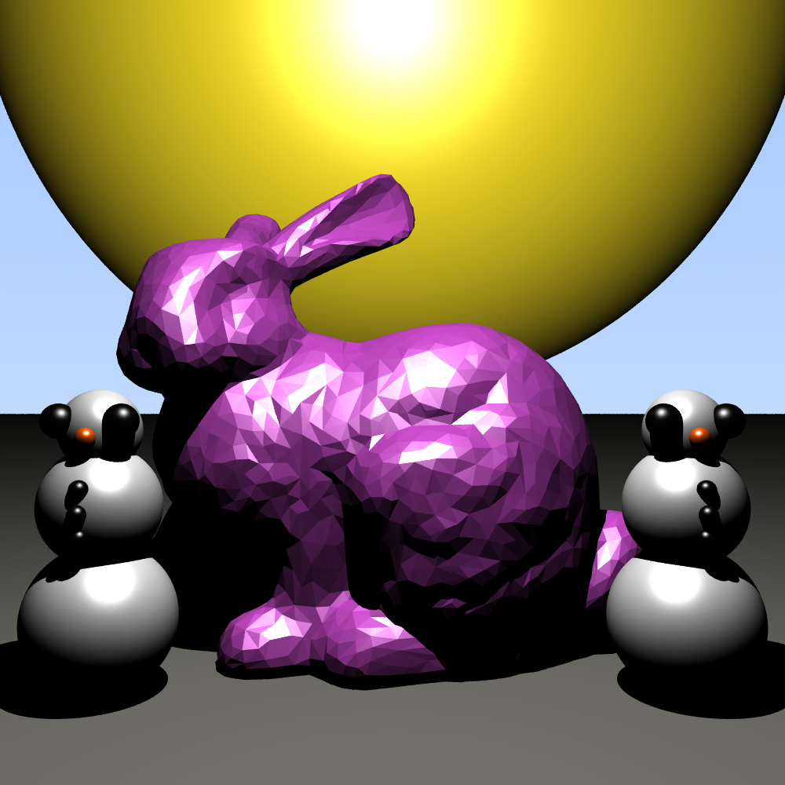
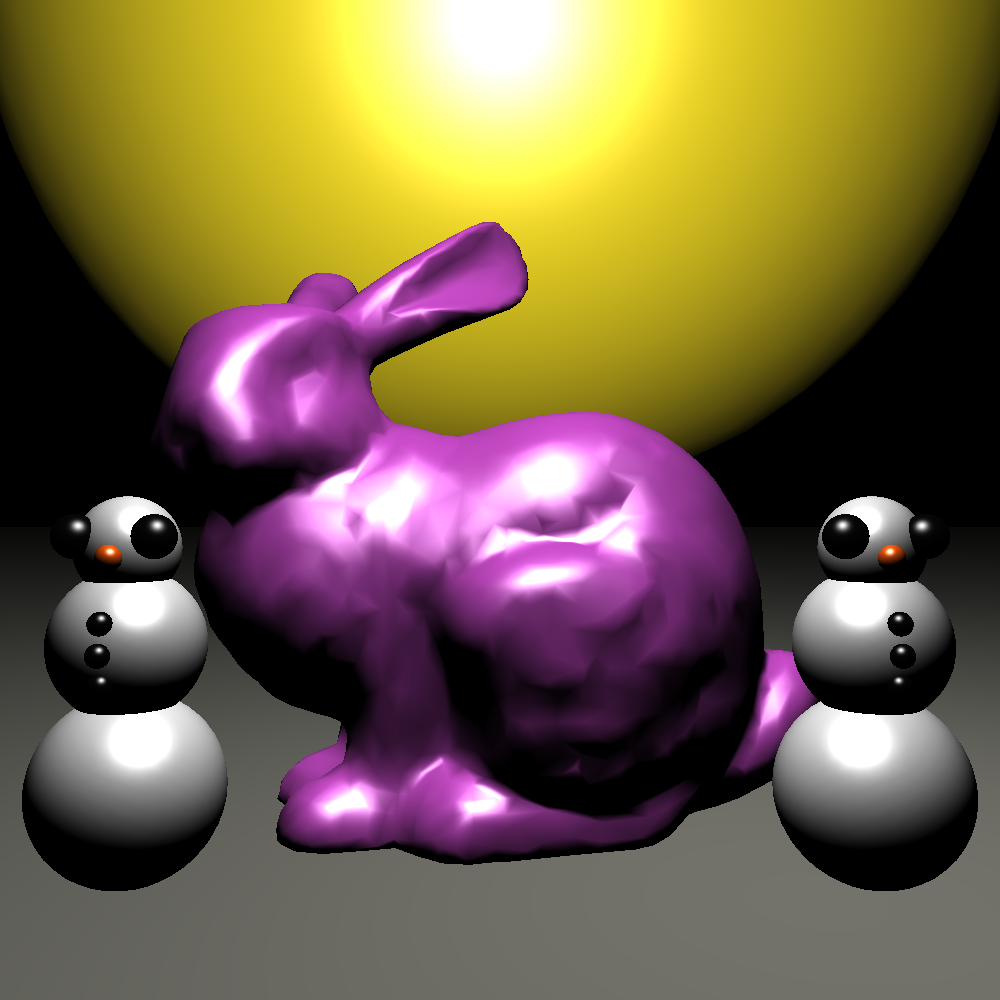

# Ray Tracer

A ray tracer that renders spheres and triangles with Lambertian, Blinn-Phong, and mirror materials. It writes PNG images through a framebuffer, and the image size comes from the command line.

## Build

This project uses CMake and [vcpkg](https://learn.microsoft.com/en-us/vcpkg/get_started/overview). `VCPKG_ROOT` must point at a bootstrapped vcpkg install.

On macOS, the renderer also needs the OpenMP runtime:

```
brew install cmake libomp
```

From the project root:

```
cmake --preset=default
cmake --build buildVCPkg
```

## Run

```
./buildVCPkg/main --width [width] --height [height]
```

With no size flags the images are 1000×1000. Passing only `--width` or only `--height` keeps the image square. `--aspect` overrides that ratio.

Running the program renders three scenes. The test scene uses every shader and is drawn with both the orthographic and the perspective camera. The snowman is an original scene. The Rubik's cube has colored mirror tiles. The three faces turned toward the camera are the ones that are lit, and a mirror stands behind the cube.

## OpenGL controls

Controls for the interactive OpenGL rasterizer (`buildVCPkg/OpenGL/glfwExample`):

| Key | Action |
|---|---|
| `W` / `S` | move camera forward / backward along its view direction |
| `A` / `D` | move camera left / right along its right vector |
| `Left` / `Right` | translate the bunny along world X |
| `Up` / `Down` | translate the bunny along world Y |
| `Z` / `X` | shrink / grow the bunny |
| `R` | toggle the bunny's continuous spin about Y |
| `1` / `2` / `3` | Lambertian / Blinn-Phong / Normal shading |
| `P` / `O` | perspective / orthographic projection |
| `Y` | print the current frames per second |
| `Esc` | quit |

## Side-by-side comparison

The same scene rendered two ways: `raytrace.png` (ray tracer) and `rasterizer.png` (OpenGL).

| Ray tracer | OpenGL rasterizer |
|---|---|
|  |  |

Both use the same geometry (bunny + two snowmen built from spheres + a sun sphere in the background), the same point light at `(0, 6, 5)`, the same camera at `(0, 0, 10)` with a 53° vertical field of view, and the same Blinn-Phong parameters (exponent 32, white specular). The ray tracer image uses 16 jittered samples per pixel; the OpenGL image is a 1000×1000 capture of the window in Blinn-Phong mode.

Visual differences:

- **Shadows.** One of the first things I noticed when comparing the two scenes was the shadows. Right now in the rasterizer there is no shadow mapping so the spheres appear to just be floating.
- **Bunny shading.** In the rasterizer, there are smooth per-vertex normals generated by the OBJ loader so the bunny appears curved while in the raytracer it appears jagged and angular. This makes it so you can see the mesh more clearly in the raytracer.
- **Background.** Another big one is the sky. The raytracer has a sky in the background where the rasterizer just is black.
- **Antialiasing.** The raytracer has 16 samples per pixel compared to the rasterizers 1 so the raytracer appears to have smoother highlights.

## Tests

```
./buildVCPkg/utests/utest_Success
```
